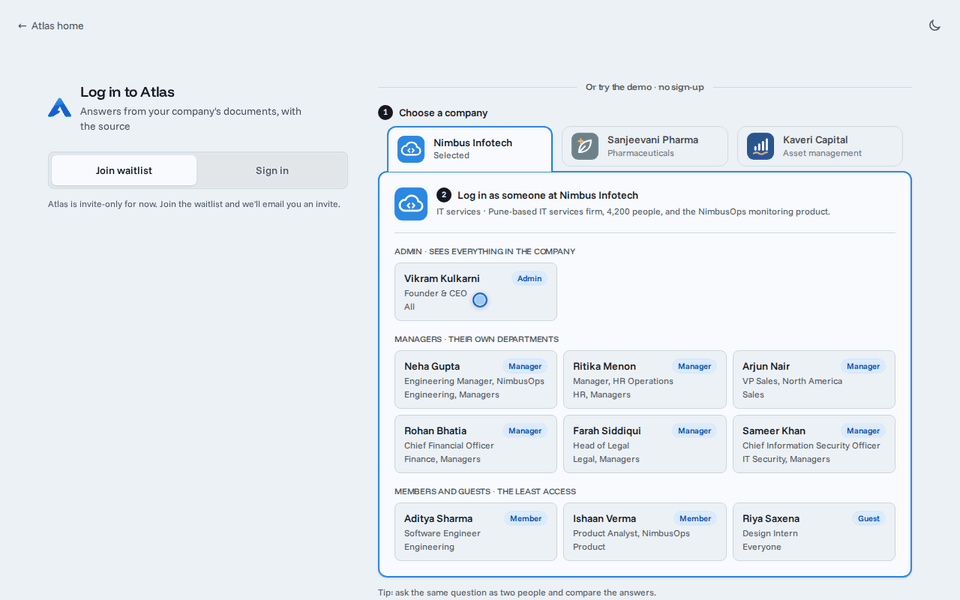
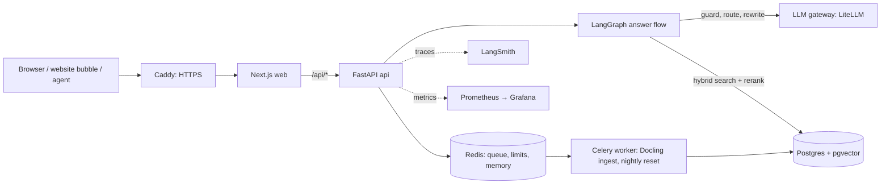

# Atlas v2

**Answers from your own documents.** Staff and website visitors ask in plain words; Atlas answers from the company's files **with the source**, and shows each person **only what they may see**.



<sub>30 s, sped up while the answer is searched. [MP4 version](docs/media/atlas-demo.mp4).</sub>

Live demo: **https://p10.kanav.space** — three made-up companies (IT services, pharma, finance), 199 documents, one-click logins for every role from employee to owner.

## What it does

- **Ask** — streamed answers with numbered citations that open the exact passage; says "not found" instead of guessing; follow-up questions remember the chat; English and Hindi.
- **Permissions in the search itself** — every passage carries its company and department; the search only ever looks at passages the person may read, so a restricted document can't leak into an answer (167-question leak test: 0 leaks).
- **Library** — upload PDF / Word / Markdown, see how each document was split into chunks, mark documents for review, superseded versions ranked down.
- **Website chat** — one `<script>` line puts a chat bubble on a company's website; it answers visitors from public documents only (allowed websites, rate limits, honeypot).
- **Agent access (MCP)** — Claude and other agents connect with a token that acts as one person: `ask_question`, `search_knowledge`, `get_document`, `list_departments`, every call audited.
- **Team, Insights, Settings** — roles and departments, what people ask and what Atlas couldn't answer, a nightly demo reset.
- **Super admin** — every company, retrieval and answer evals, model usage, the waitlist.

## How it works



One question goes: **guard** (prompt-injection and abuse check) → **route** (small talk, off-topic or a document question) → **rewrite** (uses the chat so far; Hindi → English) → **retrieve** (vector + keyword search fused with RRF, then a cross-encoder reranks the top 10, filtered by the person's access) → **grade** (score threshold, then an LLM checks the passages really answer it; retry once or say "not found") → **answer** (streamed, citations checked on the server). Full walkthrough: [docs/RAG_GUIDE.md](docs/RAG_GUIDE.md).

## Stack

| Layer | Tools |
|---|---|
| Data | **LlamaIndex** (ingestion + PGVectorStore), **Docling** (PDF/Word parsing), bge-small embeddings + jina-reranker-v1-turbo (local, FastEmbed) |
| Agent flow | **LangGraph** (state graph, Postgres checkpointer for chat memory) |
| Models | **LangChain** chat models through a LiteLLM gateway (free-tier models with fallbacks) |
| Observability | **LangSmith** traces of every AI step; Prometheus + Grafana for the service |
| Evals | **RAGAS** + own metrics (correct answer, false not-found, leaks, latency); retrieval smoke gate in CI |
| Backend | FastAPI, SQLAlchemy 2 (async), Alembic, Celery + Redis, Postgres 17 + pgvector (HNSW) |
| Frontend | Next.js 16, React, Tailwind, AI SDK UI message stream |
| SaaS | Clerk (waitlist now, sign-up next), PostHog (own tiny script, no autocapture) |
| Deploy | Docker Compose + Caddy on a VPS, GitHub Actions, Helm chart tested on kind |

*"LlamaIndex is my data layer, LangGraph is my agent workflow, LangChain is my model layer, LangSmith is my observability, and RAGAS is my eval gate."*

## Measured quality

Retrieval, 167 questions across the 3 companies (`evals/results/20261122T132819Z-retrieval.json`):

| Mode | Hit@5 | MRR | Context recall |
|---|---|---|---|
| Vector only | 0.964 | 0.856 | 0.928 |
| Keyword only | 0.952 | 0.815 | 0.886 |
| Hybrid (RRF) | 0.988 | 0.874 | 0.928 |
| **Hybrid + rerank** | **0.988** | **0.926** | **0.982** |

Answers, 224 runs (187 questions + restricted ones asked by someone who may not see them), graded blind by Claude:

| | Before (score threshold) | After (+ LLM relevance gate) |
|---|---|---|
| Fully correct | 89.2 % | ≈88.6 % (projected after the gate fix) |
| Correct or partly correct | 98.8 % | 99.4 % |
| Wrongly "not found" | 0.6 % | **0 %** |
| Proper "not found" when no document answers / the person may not see it | 10.5 % | **86 %** |
| Leaks | **0** | **0** |

The exam also found two bugs that are now fixed (the relevance grade was dropping useful passages; fallback models' `【1】` citations lost their sources). Details: [docs/RAG_GUIDE.md](docs/RAG_GUIDE.md#phase-6-answer-quality-2026-11-22).

## Run it

```sh
cp infra/.env.example infra/.env            # passwords, LLM gateway URL + key; LangSmith/Clerk/PostHog optional
docker compose -f infra/docker-compose.yml up -d --build
docker compose -f infra/docker-compose.yml exec api python -m atlas_api.scripts.seed         # demo companies + people
docker compose -f infra/docker-compose.yml exec api python -m atlas_api.scripts.load_corpus  # queue the 199 documents
```

- Web: http://127.0.0.1:3011 · API: http://127.0.0.1:8111/health/ready
- Needs an OpenAI-compatible endpoint (`ATLAS_LLM_BASE_URL`) with model names `fast` and `smart` — the live site uses a LiteLLM gateway.

**Kubernetes:** `helm install atlas infra/helm/atlas -f my-values.yaml` (see the comments in [values.yaml](infra/helm/atlas/values.yaml); CI installs it on kind on every push).

**Monitoring:** Prometheus + Grafana config in [infra/monitoring](infra/monitoring): API requests, answer outcomes and times, server CPU/memory/disk, with alert rules.

## Develop

```sh
cd apps/api && uv sync
uv run ruff check && uv run ruff format --check && uv run mypy src tests
uv run pytest -m "not integration"          # integration tests need Postgres + Redis (see CI)
cd ../web && npm ci && npm run lint && npm run typecheck && npm run build
```

Docs: [PLAN.md](PLAN.md) (what and why) · [docs/API.md](docs/API.md) (every endpoint) · [docs/RAG_GUIDE.md](docs/RAG_GUIDE.md) (the RAG pipeline step by step) · [docs/DEMO_DOCUMENTS.md](docs/DEMO_DOCUMENTS.md) (the demo data) · [PROGRESS.md](PROGRESS.md) (build log).
